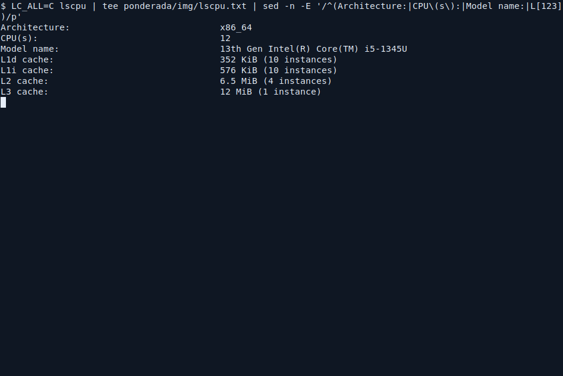
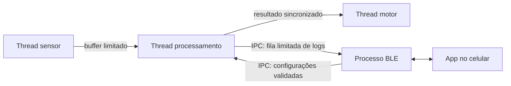
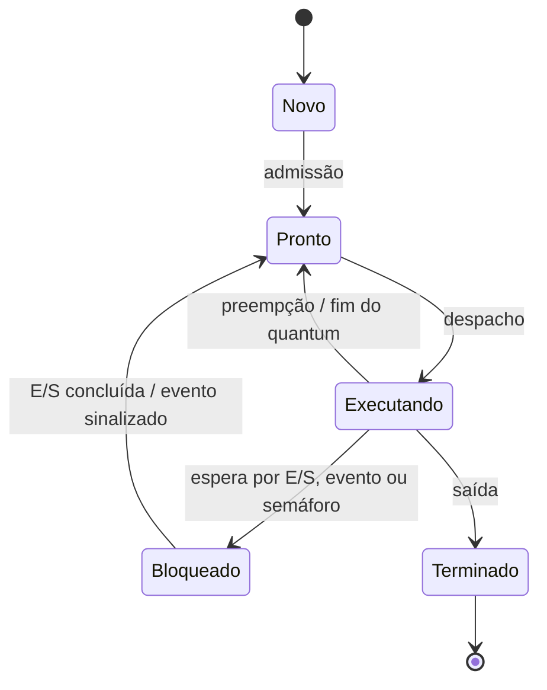
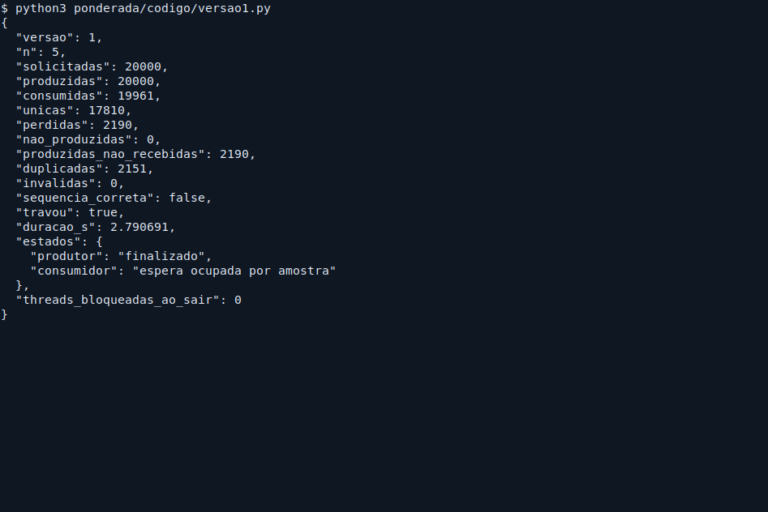
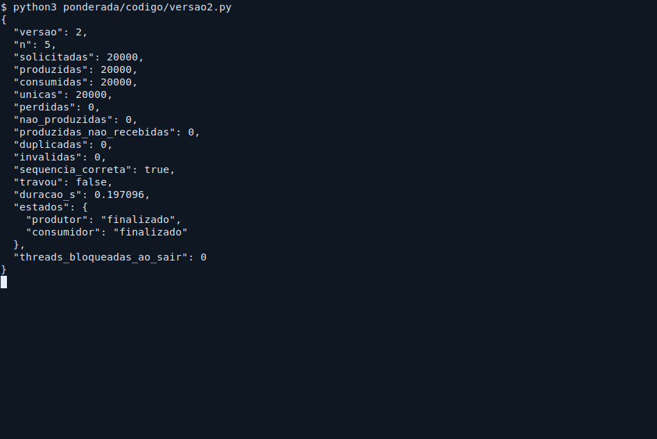
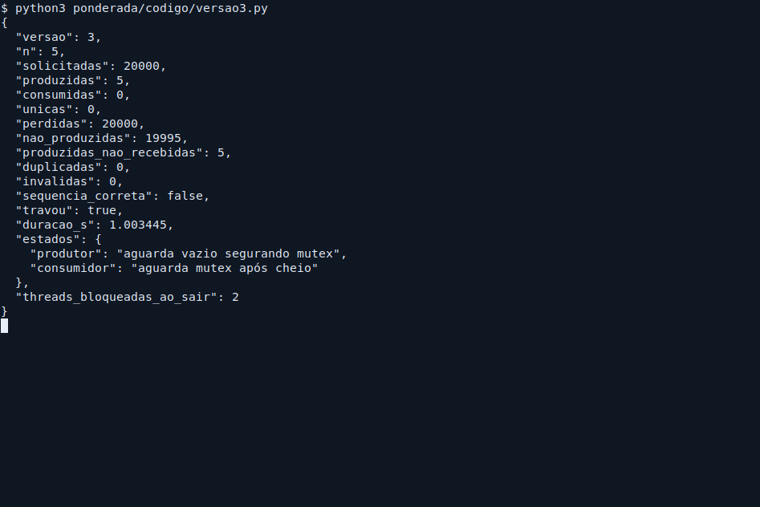
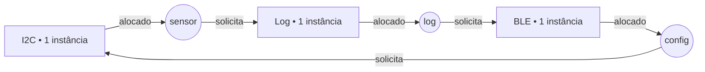

Maria Eduarda Barbosa Oliveira — D1 = 5; D2 = 7; N = 5.

# Ponderada Computação CC08: do pipeline ao deadlock

## Parâmetros individuais

Contagem somente das letras: **Maria (5) + Eduarda (7) + Barbosa (7) + Oliveira (8) = 27**.

- D1 = 5, pois o primeiro nome é Maria.
- D2 = 27 mod 10 = 7.
- IC = 100.000 + 20.000 × 7 = **240.000 instruções/amostra**.
- m = 3% + 0,5% × 5 = **5,5% = 0,055**.
- N = 3 + (7 mod 5) = 3 + 2 = **5 posições**.

A pulseira recebe 100 amostras/s: período = 1/100 s = 10 ms. O prazo de processamento é **5 ms por amostra**; conseguir acompanhar a taxa média não basta para atender esse prazo.

# Parte A — O problema técnico

## A1. Arquitetura e memória

### Plataforma H

Usando T = IC × CPI / frequência:

```text
Ciclos = 240.000 × 1,5 = 360.000 ciclos
T_H = 360.000 / 48.000.000 s = 0,0075 s = 7,5 ms
7,5 ms > 5 ms → não atende.
```

O tempo cabe no intervalo de 10 ms entre amostras, mas ultrapassa o prazo individual em 2,5 ms. Os acessos à SRAM já estão contemplados no CPI informado.

### Plataforma V

Adoto os 120 ciclos como **penalidade adicional de falta**, conforme a fórmula de CPI determinada pelo enunciado. O ciclo dura 1/(1,2 × 10⁹) s = 0,833333 ns.

```text
AMAT = tempo de acerto + m × penalidade
     = 1 + 0,055 × 120
     = 7,6 ciclos ≈ 6,333333 ns por acesso

CPI efetivo = 1,0 + (1,3 × 0,055 × 120)
            = 1,0 + 8,58 = 9,58

Ciclos/amostra = 240.000 × 9,58 = 2.299.200
T_V = 2.299.200 / 1.200.000.000 s
    = 0,001916 s = 1,916 ms

T_V com atraso máximo de SO = 1,916 + 3 = 4,916 ms
Margem = 5 − 4,916 = 0,084 ms = 84 µs = 1,68% do prazo
```

**Atende no modelo do enunciado**, com 84 µs de margem. Como a taxa de faltas é média, esse cálculo com o atraso máximo do SO não garante sozinho o prazo de toda amostra no hardware real.

### Plataforma H com DSP: Lei de Amdahl

A fração acelerada é f = 0,60; seu speedup é s = 5. A fração restante é 0,40.

```text
Speedup global = 1 / [(1 − f) + f/s]
               = 1 / [0,40 + 0,60/5]
               = 1 / 0,52 ≈ 1,923077

T_H+DSP = 7,5 × 0,52 = 3,9 ms
Conferência: filtro = 7,5 × 0,60 / 5 = 0,9 ms
             restante = 7,5 × 0,40 = 3,0 ms
             total = 0,9 + 3,0 = 3,9 ms
Margem = 5 − 3,9 = 1,1 ms = 22% do prazo
```

**Agora atende:** 3,9 ms < 5 ms, com margem de 1,1 ms.

| Plataforma | CPU por amostra | Atraso de SO considerado | Total calculado | Atende 5 ms no modelo? |
|---|---:|---:|---:|---|
| H | 7,500 ms | 0 | 7,500 ms | Não |
| V | 1,916 ms | até 3,000 ms | 4,916 ms | Sim |
| H + DSP | 3,900 ms | 0 | 3,900 ms | Sim |

### Cache e gargalo de Von Neumann — até cinco linhas

A V busca instruções e dados na hierarquia compartilhada de memória, sujeita ao gargalo de Von Neumann.<br>
A DRAM é lenta em relação ao clock de 1,2 GHz; a cache explora localidade para reduzir esses acessos.<br>
A H separa os caminhos de instruções e dados e usa SRAM interna com acesso de um ciclo.<br>
Nas condições dadas, a H não precisa de cache para esconder a latência da memória.

### Evidência da máquina



[Registro integral de `lscpu`](img/lscpu.txt). A evidência foi coletada na máquina que executou a atividade: **Intel Core i5-1345U, x86_64**. A imagem é uma captura real da janela de terminal executando `lscpu`, com um filtro para destacar CPU e caches. O comando informou:

| Nível | Capacidade agregada informada | Instâncias |
|---|---:|---:|
| L1 de dados | 352 KiB | 10 |
| L1 de instruções | 576 KiB | 10 |
| L2 | 6,5 MiB | 4 |
| L3 | 12 MiB | 1 |

Essas capacidades de L1 são somas das instâncias, não o tamanho por núcleo. **A L1 é dividida em instruções e dados.** A máquina apresenta uma arquitetura **Harvard modificada na organização das caches**, mas um modelo de memória **Von Neumann** para o software, com espaço de endereçamento unificado para código e dados. Portanto, separar L1i/L1d não transforma todo o computador em Harvard puro.

## A2. Pipeline: o loop do filtro

### Dependências RAW

Uso I1 a I7 na ordem original do enunciado. A dependência RAW liga a escrita de um valor à leitura desse mesmo valor, antes de uma nova escrita no registrador.

| Quem produz | Quem consome | Registrador | Motivo |
|---|---|---|---|
| I1: `lw x5, 0(x10)` | I2: `add x6, x6, x5` | x5 | A soma usa a amostra nova. |
| I2: `add x6, x6, x5` | I4: `sub x6, x6, x7` | x6 | A subtração usa a soma atualizada. |
| I3: `lw x7, 0(x11)` | I4: `sub x6, x6, x7` | x7 | A subtração usa a amostra antiga. |
| I4: `sub x6, x6, x7` | I5: `sw x6, 0(x12)` | x6 | A gravação usa o resultado final. |

I2 → I5 não é uma RAW direta: I4 substitui o valor de x6 antes da leitura de I5. O valor inicial de x6 vem de antes do trecho. I6/I7 atualizam os ponteiros usados em uma próxima iteração; dentro deste trecho, os respectivos `lw` precisam continuar antes desses incrementos.

### Convenções dos diagramas

Pipeline em ordem, IF/ID/EX/MEM/WB, estágios de um ciclo; sem faltas de cache nem conflitos estruturais entre busca e dados. Um estágio repetido representa uma instrução retida. A retenção em ID insere uma bolha em EX e também segura IF. O banco de registradores permite ler em ID no mesmo ciclo em que a instrução produtora escreve em WB. Em `sw`, WB é apenas a passagem final sem escrita de registrador; mantenho essa coluna para uniformizar o desenho. Nos dois diagramas da ordem original, o último WB é o de I7.

### Sem forwarding

```text
Ciclo   01 02 03 04 05 06 07 08 09 10 11 12 13 14 15 16 17
I1 lw   IF ID EX ME WB  .  .  .  .  .  .  .  .  .  .  .  .
I2 add   . IF ID ID ID EX ME WB  .  .  .  .  .  .  .  .  .
I3 lw    .  . IF IF IF ID EX ME WB  .  .  .  .  .  .  .  .
I4 sub   .  .  .  .  . IF ID ID ID EX ME WB  .  .  .  .  .
I5 sw    .  .  .  .  .  . IF IF IF ID ID ID EX ME WB  .  .
I6 addi  .  .  .  .  .  .  .  .  . IF IF IF ID EX ME WB  .
I7 addi  .  .  .  .  .  .  .  .  .  .  .  . IF ID EX ME WB
```

ME = MEM. I2 só lê x5 no ciclo 5; I4 só tem x6 e x7 disponíveis no ciclo 9; I5 só lê o resultado final de x6 no ciclo 12. Assim:

```text
Ideal = 7 instruções + (5 − 1) estágios = 11 ciclos
Bolhas = 2 para I2 + 2 para I4 + 2 para I5 = 6
Total = 11 + 6 = 17 ciclos
```

A espera de I4 por x7 também cobre a disponibilidade de x6; não se somam duas penalidades independentes para o mesmo intervalo.

### Com forwarding

Assumo forwarding completo de resultados de ALU, de cargas e do dado a gravar por `sw`. A especificação “com forwarding” precisa incluir o caminho de dados do store para obter este total.

```text
Ciclo   01 02 03 04 05 06 07 08 09 10 11 12 13
I1 lw   IF ID EX ME WB  .  .  .  .  .  .  .  .
I2 add   . IF ID ID EX ME WB  .  .  .  .  .  .
I3 lw    .  . IF IF ID EX ME WB  .  .  .  .  .
I4 sub   .  .  .  . IF ID ID EX ME WB  .  .  .
I5 sw    .  .  .  .  . IF IF ID EX ME WB  .  .
I6 addi  .  .  .  .  .  .  . IF ID EX ME WB  .
I7 addi  .  .  .  .  .  .  .  . IF ID EX ME WB
```

```text
Total = 11 + 1 bolha (I1 → I2) + 1 bolha (I3 → I4)
      = 13 ciclos
```

As duas dependências de uso imediato de carga continuam causando bolha. O `lw` só produz o dado ao final de MEM; a instrução seguinte precisaria dele no início de EX desse mesmo ciclo. Forwarding não antecipa um valor ainda indisponível. Referência conceitual: [Berkeley CS 61C — Data Hazards](https://notes.cs61c.org/content/pipeline-hazards/data-hazards/).

### Reordenação sem bolhas

```asm
lw   x5, 0(x10)     # I1: lê antes de incrementar x10
addi x10, x10, 4    # I6: ocupa a distância necessária após o load
add  x6, x6, x5     # I2
lw   x7, 0(x11)     # I3: lê antes de incrementar x11
addi x11, x11, 4    # I7: ocupa a distância necessária após o load
sub  x6, x6, x7     # I4
sw   x6, 0(x12)     # I5
```

```text
Ciclo   01 02 03 04 05 06 07 08 09 10 11
I1 lw   IF ID EX ME WB  .  .  .  .  .  .
I6 addi  . IF ID EX ME WB  .  .  .  .  .
I2 add   .  . IF ID EX ME WB  .  .  .  .
I3 lw    .  .  . IF ID EX ME WB  .  .  .
I7 addi  .  .  .  . IF ID EX ME WB  .  .
I4 sub   .  .  .  .  . IF ID EX ME WB  .
I5 sw    .  .  .  .  .  . IF ID EX ME WB
```

Cada carga tem uma instrução independente antes do uso. O store recebe x6 por forwarding. São **7 + 4 = 11 ciclos**, incluindo o WB convencional do store; a gravação em memória ocorre no ciclo 10. Preservei a ordem das operações de memória e a ordem das atualizações de x6, mantendo o resultado e os ponteiros finais.

## A3. Processos e threads

### Organização proposta para a Plataforma V

| Processo | Threads/tarefas | Justificativa |
|---|---|---|
| Controle sensorial | Leitura do sensor, processamento e acionamento do motor | Compartilham amostras e resultados em buffers limitados, evitando serialização e cópias entre processos no caminho crítico. |
| Comunicação BLE | Envio de logs e recepção de configurações | Recebe entrada externa; uma falha deve poder reiniciar esse serviço sem derrubar diretamente o controle sensorial. |

As três threads de controle são criadas na inicialização. Threads compartilham o espaço de endereçamento, têm criação geralmente mais barata e evitam trocar esse espaço a cada troca de contexto entre elas. Ainda há custo de escalonamento e necessidade de sincronização. O processo BLE exige recursos próprios e comunicação entre processos (IPC), mas seu custo de criação é pago na inicialização ou reinicialização, não a cada amostra.



O motor não espera um envio BLE terminar. Se a fila de logs encher, descarto logs e registro a quantidade descartada; a retroalimentação de segurança continua. Comandos entram por mensagens limitadas em tamanho e frequência, são validados no controle e aplicados em fronteiras de amostra. O BLE roda com privilégios mínimos, sem acesso direto ao motor ou à memória do processo principal. As filas do caminho crítico precisam ter esperas limitadas pelo orçamento de 5 ms; o timeout didático de 1 s da A4 não serve para produção.

### Se o BLE for explorado

Como thread do processo principal, o BLE compartilha memória e permissões: código malicioso pode alterar amostras, ponteiros, resultados e o estado do motor; um erro de memória pode derrubar todas as tarefas. Em um processo separado e com permissões restritas, há isolamento de endereçamento, reinício independente e uma interface de mensagens controlada. O risco continua existindo por mensagens maliciosas, consumo excessivo de CPU e falhas do SO; por isso, isolamento deve vir acompanhado de validação e limites de recursos.

### Estados de um processo



A thread do sensor passa a maior parte do tempo **bloqueada**, esperando o temporizador de 10 ms ou a interrupção de leitura pronta, se a leitura for curta em relação ao período. Quando acorda, fica pronta até ser escalonada; lê, publica e volta a esperar. Não deve gastar esse intervalo consultando repetidamente o sensor. Em um processo multithread, uma thread bloqueada não impede outra de executar: o diagrama representa o ciclo clássico aplicado também às entidades escalonáveis.

## A4. Buffer circular com semáforos

### Implementação e método

Os pontos de entrada são [versao1.py](codigo/versao1.py), [versao2.py](codigo/versao2.py) e [versao3.py](codigo/versao3.py). O comportamento compartilhado e as diferenças estão em [experimento.py](codigo/experimento.py). Todos usam **N = 5**, uma produtora e uma consumidora, com IDs esperados de 0 a 19.999.

Cada repetição roda em um processo novo. O consumidor aguarda inicialmente **50 ms nas três versões**, permitindo exercitar a situação válida de o produtor encher o buffer antes de o motor ser escalonado. Esse atraso é uma injeção de escalonamento para o experimento, não uma latência proposta para a pulseira. Não há intervalo de 10 ms entre amostras no ensaio: é um teste de concorrência com 20.000 amostras, não uma medição de tempo real.

Na V1, a espera ocupada consulta repetidamente o contador; `sleep(0)` cede a CPU sem esperar por um evento de disponibilidade. Há também o `sleep(0)` exigido **entre ler e escrever o contador** em ambas as threads. Eventos de controle de término não protegem o buffer nem tornam atômica a atualização do contador.

Um monitor usa relógio monotônico e encerra após **1 s sem consumo**, com verificação a cada 5 ms. Conta esse prazo desde o início, se nenhuma amostra chegou. Registra o estado das threads antes de solicitar parada. As aquisições de semáforos são bloqueantes: o monitor não libera artificialmente o mutex. Na V3, as duas threads continuam bloqueadas até o processo encerrar; o tempo de observação do JSON exclui até 200 ms adicionais usados em `join` limitado.

Para não confundir duplicatas com conclusão, a V1 só termina normalmente após pelo menos 20.000 leituras **e** a conclusão da produtora. Assim, pode registrar mais de 20.000 leituras. Se não avançar por 1 s, termina por travamento. O encerramento antecipado por falha pode deixar IDs sem produção.

### Contagem e resultados observados

Definições: **consumidas** é o total de leituras; **únicas** é a quantidade de IDs válidos distintos; **duplicadas** = leituras válidas − únicas; **perdidas** = 20.000 − únicas. “Perdidas” mede amostras esperadas que não chegaram, incluindo as não produzidas por interrupção do experimento. Os JSONs distinguem `nao_produzidas` e `produzidas_nao_recebidas`. Não trato 20.000 leituras repetidas como entrega correta.

| Versão | Execução | Produzidas | Consumidas | Únicas | Perdidas | Duplicadas | Travou? |
|---|---:|---:|---:|---:|---:|---:|---|
| 1 | 1 | 20.000 | 19.961 | 17.810 | 2.190 | 2.151 | Sim |
| 1 | 2 | 20.000 | 19.955 | 17.692 | 2.308 | 2.263 | Sim |
| 1 | 3 | 20.000 | 19.833 | 17.639 | 2.361 | 2.194 | Sim |
| 2 | 1 | 20.000 | 20.000 | 20.000 | 0 | 0 | Não |
| 2 | 2 | 20.000 | 20.000 | 20.000 | 0 | 0 | Não |
| 2 | 3 | 20.000 | 20.000 | 20.000 | 0 | 0 | Não |
| 3 | 1 | 5 | 0 | 0 | 20.000 | 0 | Sim |
| 3 | 2 | 5 | 0 | 0 | 20.000 | 0 | Sim |
| 3 | 3 | 5 | 0 | 0 | 20.000 | 0 | Sim |

Na V1, as três produtoras chegaram às 20.000 inserções, mas o consumidor perdeu IDs, repetiu outros e terminou por 1 s sem receber. Por exemplo, na primeira execução, 19.961 leituras − 2.151 duplicatas = 17.810 IDs únicos; 20.000 − 17.810 = **2.190 amostras não entregues**. Esse travamento operacional da V1 decorre do contador incoerente e não é o ciclo de espera por semáforos observado na V3. Não houve leitura inválida em nenhuma das nove execuções.

Os registros completos das nove execuções estão em [resultados.json](codigo/resultados.json) e nos textos [V1](img/versao1.txt), [V2](img/versao2.txt) e [V3](img/versao3.txt). A coleta usa Python 3.12.3 em Linux, em 06/11/2026 (America/Sao_Paulo). As imagens abaixo são capturas reais das janelas de terminal durante a primeira execução de cada versão, na mesma coleta dos registros.







### Região crítica e corrida da versão 1

A região crítica compreende verificar disponibilidade, acessar a posição do buffer e atualizar o estado que publica ou retira a amostra. O contador `ocupadas` é compartilhado; o produtor e o consumidor fazem operações de leitura–modificação–escrita concorrentes. Cada índice pertence a uma thread, mas sua relação com a ocupação e com as posições válidas depende da consistência desse protocolo.

Exemplo de atualização perdida, começando com ocupadas = 1:

```text
Produtor lê ocupadas = 1 e é interrompido.
Consumidor lê ocupadas = 1 e é interrompido.
Produtor publica sua atualização: ocupadas = 2.
Consumidor publica sua atualização antiga: ocupadas = 0.
Resultado correto após uma inserção e uma retirada seria 1, não 0.
```

A ordem inversa das últimas escritas deixa o contador em 2, também incorreto. Subestimar a ocupação permite sobrescrever amostras ainda não lidas; superestimá-la permite reler posições com valores antigos. As posições não são apagadas após leitura, portanto a leitura indevida de um slot antigo aparece como duplicata. Um contador incoerente também pode impedir progresso. O GIL não torna essa sequência inteira atômica: há uma cessão explícita de execução entre a leitura e a escrita.

### O que os três semáforos garantem na versão 2

| Semáforo | Inicial | Garantia |
|---|---:|---|
| `vazio` | 5 | Reserva um espaço antes de produzir; impede sobrescrever uma posição ainda ocupada. |
| `cheio` | 0 | Reserva uma amostra publicada antes de consumir; impede ler buffer vazio. |
| `mutex` | 1 | Permite somente uma thread na manipulação protegida do buffer e de seus índices por vez. |

```text
Produtor:   P(vazio) → P(mutex) → insere → V(mutex) → V(cheio)
Consumidor: P(cheio) → P(mutex) → retira → V(mutex) → V(vazio)
```

`P` é `acquire`; `V` é `release`. A espera por capacidade ou dados ocorre antes de segurar o mutex, permitindo que a outra thread altere o estado necessário. Os semáforos substituem o contador manual como controle de disponibilidade. Referência da API: [Python — Semaphore objects](https://docs.python.org/3/library/threading.html#semaphore-objects).

Nas três execuções corretas foram consumidos **20.000 IDs distintos, na sequência exata 0…19.999**, sem perdas, duplicatas, valores inválidos ou travamento. Os testes confirmam o comportamento observado; a justificativa de correção vem do protocolo de exclusão e contagem.

### O que aconteceu na versão 3

O produtor inseriu cinco amostras e preencheu o buffer. Ao tentar inserir a sexta, adquiriu `mutex` e bloqueou em `vazio`, cujo contador era zero. O consumidor conseguiu adquirir `cheio`, mas bloqueou tentando obter o mutex. Para liberar `vazio`, precisaria primeiro retirar uma amostra; para retirá-la, precisaria do mutex que o produtor não libera.

```text
Produtor segura mutex → espera espaço liberado pelo consumidor
Consumidor espera mutex → não consegue retirar e liberar espaço
```

As três execuções travaram sem consumir amostras. Das **20.000 esperadas**, cinco foram produzidas e ficaram presas; **19.995 nem chegaram a ser produzidas**. Portanto, a tabela informa 20.000 perdidas no sentido de não entregues, sem afirmar que 20.000 valores foram sobrescritos. O atraso inicial torna esse escalonamento reproduzível; a ordem errada admite deadlock, mas não significa que todo escalonamento possível necessariamente trave.

## A5. Deadlock: a pulseira congelou

### Sequência de execução

Os três semáforos têm uma unidade disponível inicialmente.

1. `thread_sensor` executa `P(i2c)`, lê o sensor e é interrompida antes de `P(log)`.
2. `thread_log` executa `P(log)`, lê o log e é interrompida antes de `P(ble)`.
3. `thread_config` executa `P(ble)`, recebe o comando e é interrompida antes de `P(i2c)`.
4. `thread_sensor` tenta `P(log)` e bloqueia: log está com `thread_log`.
5. `thread_log` tenta `P(ble)` e bloqueia: BLE está com `thread_config`.
6. `thread_config` tenta `P(i2c)` e bloqueia: I2C está com `thread_sensor`.

Nenhuma thread alcança suas operações `V`. No grafo, **recurso → thread** indica alocação e **thread → recurso** indica solicitação pendente. Cada recurso tem uma única instância.



O ciclo é I2C → sensor → log → thread_log → BLE → config → I2C. Com uma instância por recurso, esse ciclo caracteriza deadlock.

### As quatro condições necessárias

| Condição | Como aparece no código |
|---|---|
| Exclusão mútua | Cada semáforo permite que apenas uma thread possua o respectivo recurso. |
| Posse e espera | Cada thread mantém o primeiro recurso enquanto espera o segundo. |
| Ausência de preempção de recursos | Nenhum mecanismo retira o recurso da thread; a liberação depende do `V` feito por ela. Preempção da CPU não libera semáforos. |
| Espera circular | Sensor espera log, log espera configuração e configuração espera sensor, fechando o ciclo. |

A distinção entre prevenção, detecção e recuperação segue o modelo de [UIC — Operating Systems: Deadlocks](https://www.cs.uic.edu/~jbell/CourseNotes/OperatingSystems/7_Deadlocks.html).

### Correção 1: prevenção por ordem global

Defino a ordem **I2C < log < BLE**. Toda thread adquire os recursos de que precisa em ordem crescente e libera em ordem inversa:

```text
sensor: P(i2c) → P(log) → operações → V(log) → V(i2c)
log:    P(log) → P(ble) → operações → V(ble) → V(log)
config: P(i2c) → P(ble) → operações → V(ble) → V(i2c)
```

A configuração deixa de adquirir I2C enquanto segura BLE. Como as esperas só avançam na ordem dos recursos, não se forma um ciclo. O recebimento demorado de comandos deve ocorrer antes da seção crítica, em armazenamento privado, e a aplicação do comando deve ser curta. Evito manter I2C durante espera de rede. A imposição de ordem precisa valer em todos os caminhos, inclusive erros e callbacks.

**Impacto para quem usa:** elimina esse congelamento por espera circular. Comandos e logs podem esperar mais pela serialização. Ainda preciso limitar a duração das seções críticas para cumprir 5 ms; ausência de deadlock não elimina atraso ou inversão de prioridade.

### Correção 2: detecção e recuperação controlada

Instrumento aquisições/liberações para manter um grafo de espera por thread. Um supervisor detecta ciclos; o monitoramento de progresso serve como gatilho para investigar, sem confundir todo atraso com deadlock. Confirmado o ciclo, solicita cancelamento de uma operação de configuração ou log, preferindo preservar o caminho sensorial.

Para a recuperação ser possível, essas operações usam aquisições com prazo, verificam cancelamento e têm um protocolo de desfazer alterações parciais. A thread escolhida abandona a operação e libera **somente os recursos que adquiriu**, em `finally`, quebrando o ciclo. Configurações são validadas antes e aplicadas de modo consistente. Não basta matar uma thread ou chamar `release` indiscriminadamente: isso pode deixar dados e periféricos corrompidos. Se uma thread não cooperar, a alternativa de último recurso é reinicializar o subsistema e restaurar seu estado conhecido.

**Impacto para quem usa:** pode haver perda de um log, rejeição de uma configuração e interrupção temporária do serviço, que deve ser sinalizada. A detecção consome recursos e não evita a primeira interrupção; não considero esse mecanismo, isoladamente, prova do prazo de 5 ms. Para produção, priorizo a prevenção e mantenho a recuperação como proteção adicional.

# Parte B — Decisão do CTO

## Memorando ao conselho da Tato — Dilema 2

**Decido produzir a Tato com a Plataforma H e o acelerador DSP, ao custo de R$ 37 por unidade.**

Com meus parâmetros, H sozinha leva 7,5 ms e viola o prazo de 5 ms. O DSP reduz o tempo para 3,9 ms, deixando 1,1 ms de margem. A Plataforma V chega a 4,916 ms no cálculo da A1: sobra apenas 84 µs. Prefiro a margem maior de H com DSP para uma função cujo atraso pode ocultar um obstáculo.

Essa escolha economiza R$ 70 − R$ 37 = **R$ 33 por unidade** frente à V, mas abre mão de atualizações pela internet. A empresa paga pela assistência, logística e manutenção do firmware; a pessoa usuária pode enfrentar deslocamento e tempo sem o dispositivo. Destinarei parte da economia ao atendimento e à disponibilização de unidades de substituição durante correções. Esse suporte reduz a economia efetiva e precisa entrar no orçamento.

Para quem usa, o benefício esperado é maior margem para receber a vibração dentro do prazo. O risco escolhido é uma correção de segurança demorar a chegar porque depende de cabo e assistência. Ausência de Linux não elimina vulnerabilidades de BLE ou do firmware: exigirei validação de comandos e autenticação das atualizações, e restringirei o acesso do módulo de comunicação ao controle sensorial. Os 3,9 ms são uma projeção; a liberação depende de validar também transferência ao DSP, aquisição e acionamento no hardware real.

Mudarei para a V se uma implementação com atualização autenticada e isolamento do BLE demonstrar um **limite de pior caso de até 4,0 ms por amostra**, incluindo interferência do SO, memória e BLE sob a carga especificada. Isso preservaria pelo menos 1,0 ms de margem e justificaria reavaliar os R$ 33 adicionais pelo benefício de corrigir falhas remotamente.

Maria Eduarda Barbosa Oliveira — CTO da Tato
